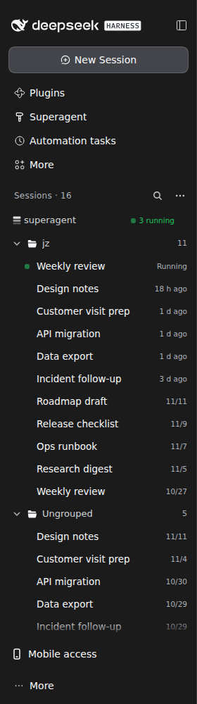
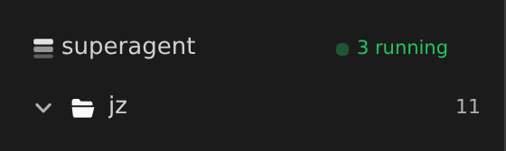

# dsh-superagent-session-fold

[](https://github.com/yichao-agent/dsh-superagent-session-fold/stargazers)
[](https://github.com/yichao-agent/dsh-superagent-session-fold/watchers)
[](LICENSE)

A [DeepSeek Harness](https://github.com/deepseek-ai/deepseek-harness) (DSH) client plugin that keeps the sidebar usable when `dsh-superagent` spawns one workspace per worker task.

[中文说明](README.zh.md)



## The problem

`dsh-superagent` creates a Workspace for every worker session, so the sidebar accumulates one directory per task (86 of 89 workspaces on the machine this was built for). The native browser can nest them under a collapsed tree, but expanding it lists every task directory again, and the worker sessions still compete with your own conversations for attention.

## What this plugin does

- **Contains** all sessions whose workspace lives under the superagent state directory (`/.dsh/state/superagent` by default). They no longer appear in the sidebar session list — not as rows, not as directories.
- Leaves **one status row** at the superagent parent's place in the registry order (top when something needs attention):

  

  It reports `N running`, `N waiting`, or `N tasks`. The row moves to the top while a worker is running or waiting for a human.
- **Clicking the row opens the superagent main conversation** (the live `orchestrator-*` session). The management panel already has its own `Superagent` entry in the upper navigation, so the sidebar row is for the conversation, not the panel.
- **Never expands the tree.** Task directories cannot leak back into the sidebar; expandable containment was the previous version and defeated the purpose.
- Other workspaces keep their grouped/expanded list, search still finds contained sessions by title, and no session or workspace data is modified.

## Install

The plugin is a DSH bundle (Host no-op + Client module).

### Plugin Manager

1. Clone or download this repository to a local directory.
2. Open **Settings → Plugins → Add plugin** and install that directory.
3. Reload the Web page (the Client module is loaded at page boot; a reload is required after install or update).

### CLI

```bash
dsh plugin --profile web add /absolute/path/to/dsh-superagent-session-fold
```

Then restart or reload the Web UI. Disable the plugin to get the shipped sidebar browser back immediately — nothing on disk is changed.

Requirements: DSH `0.2.2-rc.3` (tested). The superagent integration is optional; without `dsh-superagent` the containment row still collapses the state directory but the master-session fallback opens the most recent session there.

## Configuration

Defaults work for a standard DSH + superagent installation. Advanced overrides live in the page's `localStorage` (no host config is read):

| Key | Default | Meaning |
| --- | --- | --- |
| `dsh-superagent-session-fold.roots.v1` | `["/.dsh/state/superagent"]` | JSON array of path fragments whose workspaces are contained. Matching is boundary-aware: `/.dsh/state/superagent` matches the parent and every task below it. |
| `dsh-superagent-session-fold.showArchived.v1` | `false` | Whether archived sessions are listed in the normal groups. |
| `dsh-superagent-session-fold.expanded.v1` | `{}` | Expansion state of normal workspaces only; containment and task folders are never persisted as expanded. |

Older installs (`dsh-session-fold`) keep their view state: the legacy `dsh-session-fold.*` keys are still read as a fallback.

Example, to also contain another script directory:

```js
localStorage.setItem('dsh-superagent-session-fold.roots.v1', JSON.stringify([
  '/.dsh/state/superagent',
  '/.dsh/state/other-agent',
]))
location.reload()
```

## How it works

The Client module registers at `priority: -10` into the single `sidebar.workspaces` slot, shadowing the shipped `WorkspaceBrowser`. It reads only standard root hooks (`useSessions`, `useWorkspaces`, `useSessionStatus`) and acts through public services (`ctx.uiWorkspace.openSession`, `ctx.layout.selectPanel`). It does not import any other Harness Client package and does not append DOM outside its own component.

Master-session resolution, in order:

1. The newest session whose id starts with `orchestrator-` in the superagent parent workspace.
2. The first visible session of that workspace.
3. `GET /orchestrator/api/state` (same-origin, `x-orchestrator-request: 1`).
4. The management panel.

Disabling the bundle removes the registration and the shipped browser wins again.

## Limitations

- While enabled, the shipped browser's workspace management is absent: adding/renaming/deleting workspaces, drag ordering, view options, and row decorations from other plugins (chat-channel avatars, schedule marks, hover cards) are not rendered.
- The plugin replaces a single slot from another package; a DSH release that renames `sidebar.workspaces` or changes its standard props needs a plugin update.
- Client modules are loaded at page boot: after installing or updating, reload the page; the running page does not hot-replace this bundle.
- Containment is intentionally not expandable in place. Use the Superagent panel or search to reach a worker session.

## Development

```
client.js            Client module (plain JS, React from the module table)
index.js             Host half (no-op; keeps the bundle a Loader entry)
cordis.patch.yml     Bundle patch inserting the superagent-session-fold row
locale/              Plugin Manager display metadata (en, zh)
docs/                Plugin detail document, preview, screenshots
```

Syntax check and install:

```bash
node --check client.js
dsh plugin --profile web add "$PWD"
```

The design contract for the slot, hooks, and services is documented by DSH itself (`dsh-doc` skill); check `Slots.listSubTree` for `sidebar.workspaces` after a DSH upgrade.

## Star history

[](https://star-history.com/#yichao-agent/dsh-superagent-session-fold&Date)

The chart is served by [star-history.com](https://star-history.com) and updates automatically as the repository gains stars; the badges above are live shields.io images.

## License

MIT. See [LICENSE](LICENSE).
