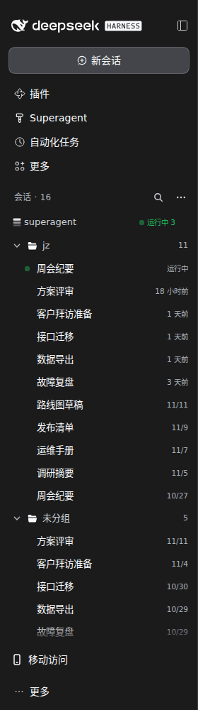
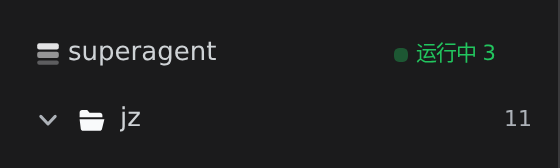
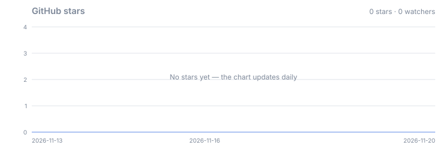

# dsh-session-fold

[](https://github.com/yichao-agent/dsh-session-fold/stargazers)
[](https://github.com/yichao-agent/dsh-session-fold/watchers)
[](LICENSE)

[DeepSeek Harness](https://github.com/deepseek-ai/deepseek-harness)（DSH）客户端插件：当 `dsh-superagent` 为每个 worker 任务创建一个工作区时，让侧边栏保持可用。

[English](README.md)



## 问题

`dsh-superagent` 会为每个 worker 会话创建一个 Workspace，于是侧边栏里每个任务对应一个目录（在开发机上曾达到 89 个工作区中的 86 个）。原生浏览器虽然能用树形把子目录折叠到父节点下，但一展开就又把 80 多个任务目录列出来，而且 worker 会话始终和你的会话抢注意力。

## 这个插件做什么

- **收容**所有工作目录位于 superagent 状态目录（默认 `/.dsh/state/superagent`）下的会话：它们不再出现在侧边栏会话列表里——既不作为会话行，也不作为目录。
- 只保留**一行状态入口**，放在父工作区在注册表里的位置（有任务需要关注时自动置顶）：

  

  它显示 `运行中 N`、`待处理 N` 或 `N 个任务`；有 worker 在跑或等待人工处理时，这一行会浮到最上面。
- **点击这一行打开 Superagent 主会话**（当前活跃的 `orchestrator-*` 会话）。管理面板本来就在顶部导航里有自己的 `Superagent` 入口，所以侧边栏这一行用来回到主对话。
- **不提供原地展开**。任务目录不能再漏回侧边栏；上一版的“可展开收容”会重新摊开子树，等于没收容。
- 其他工作区照旧按目录分组展示；搜索仍能按标题找到被收容的会话；插件不修改任何会话或工作区数据。

## 安装

插件是一个 DSH bundle（Host 空壳 + Client 模块）。

### 通过插件管理界面

1. 克隆或下载本仓库到本地目录；
2. 打开 **设置 → 插件 → 添加插件**，安装该目录；
3. 刷新 Web 页面（Client 模块在页面启动时加载，安装/更新后必须刷新）。

### 命令行

```bash
dsh plugin --profile web add /absolute/path/to/dsh-session-fold
```

然后重启或刷新 Web UI。停用插件会立即恢复原生侧边栏浏览器；磁盘上的任何数据都不会被改动。

要求：DSH `0.2.2-rc.3`（已实测）。superagent 集成是可选的；没有 `dsh-superagent` 时，收容行仍会折叠该状态目录，只是点击时回退到该目录下最近的会话。

## 配置

标准 DSH + superagent 安装无需配置。高级覆盖项放在页面的 `localStorage` 中（不读取 Host 配置）：

| 键 | 默认值 | 含义 |
| --- | --- | --- |
| `dsh-session-fold.roots.v1` | `["/.dsh/state/superagent"]` | JSON 数组，路径片段；匹配是边界感知的，`/.dsh/state/superagent` 会命中父目录及其下所有任务目录。 |
| `dsh-session-fold.showArchived.v1` | `false` | 普通分组里是否显示已归档会话。 |
| `dsh-session-fold.expanded.v2` | `{}` | 只保存普通工作区的展开状态；收容行和任务目录不会被持久化为展开。 |

例如把另一个脚本目录也收容：

```js
localStorage.setItem('dsh-session-fold.roots.v1', JSON.stringify([
  '/.dsh/state/superagent',
  '/.dsh/state/other-agent',
]))
location.reload()
```

## 实现方式

Client 模块以 `priority: -10` 注册到单例槽位 `sidebar.workspaces`，遮蔽原生 `WorkspaceBrowser`。它只读取标准根 Hook（`useSessions`、`useWorkspaces`、`useSessionStatus`），通过公开 Service（`ctx.uiWorkspace.openSession`、`ctx.layout.selectPanel`）执行动作，不导入其他 Harness Client 包，也不在自己的组件之外写 DOM。

主会话按以下顺序解析：

1. superagent 父工作区里 id 以 `orchestrator-` 开头、更新时间最新的会话；
2. 该工作区第一个可见会话；
3. `GET /orchestrator/api/state`（同源，带 `x-orchestrator-request: 1`）；
4. 管理面板。

停用 bundle 后注册被移除，原生浏览器重新生效。

## 限制

- 启用期间，原生浏览器的部分能力不可用：添加/重命名/删除工作区、拖拽排序、视图选项、以及其他插件的行装饰（IM 头像、日程标记、悬浮卡）。
- 插件遮蔽的是另一个包声明的单例槽位；若 DSH 升级重命名 `sidebar.workspaces` 或其标准 props，插件需要跟进。
- Client 模块在页面启动时加载：安装或更新后要刷新页面，运行中的页面不会热替换这个 bundle。
- 收容在侧边栏内刻意不可展开；要看 worker 会话请用 Superagent 面板或搜索。

## 开发

```
client.js            Client 模块（纯 JS，React 来自模块表）
index.js             Host 空壳（保证 bundle 有 Loader 条目）
cordis.patch.yml     bundle 补丁，插入 session-fold 条目
locale/              插件管理界面的展示元数据（中/英）
docs/                插件详情页、预览图、截图
scripts/             定时工作流使用的 star-history 渲染脚本
```

语法检查与安装：

```bash
node --check client.js
dsh plugin --profile web add "$PWD"
```

槽位、Hook 与 Service 的契约以 DSH 自带文档为准；DSH 升级后可用 `Slots.listSubTree` 检查 `sidebar.workspaces`。

## Star 历史



该图由 [`.github/workflows/star-history.yml`](.github/workflows/star-history.yml) 每天通过 GitHub API 重新生成并提交（累计 star 数 + 最新 watcher 数）。上面的徽章由 shields.io 实时生成。

## 许可证

MIT，见 [LICENSE](LICENSE)。
